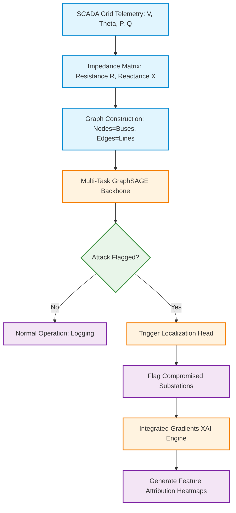
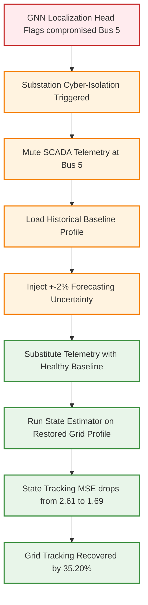

# Guide: Project Flowcharts & AI Diagram Prompts

This guide provides both **Mermaid.js code** (for rendering diagrams directly in Markdown/Notion) and **Miro AI Prompts** (to generate interactive, editable diagrams in Miro).

---

## 📊 Flowchart 1: The Graph Digital Twin Security Pipeline
This diagram explains the step-by-step processing of grid telemetry through the Graph Digital Twin, GNN model, and explainability engine.

### 1. Mermaid.js Code
*Copy this block into any Markdown viewer (GitHub, Notion, Obsidian) to render the flowchart:*

### 2. Miro AI Prompt
*Copy and paste this prompt into Miro AI (Command: "/generate flowchart" or use the Miro AI App) to create the diagram:*

> "Generate a professional technical flowchart for a Graph Digital Twin smart grid cyber-security pipeline. Start with SCADA Telemetry (Voltage Magnitude V, Angle Theta, Active Power P, Reactive Power Q) and Grid Impedance parameters (R, X) feeding into 'Graph Construction'. From Graph Construction, point to 'Multi-Task GraphSAGE Backbone'. Then, branch into a decision block named 'Attack Detected?'. If No, point to 'Normal Operation'. If Yes, point to 'Substation Localization Head' which identifies compromised nodes. Finally, point the Localization Head to 'Integrated Gradients Explainability (XAI) Engine' to generate node-level attribution maps for utility operators."

---

## 🔄 Flowchart 2: The Closed-Loop Cyber-Mitigation Loop
This diagram explains the active grid healing loop once the GDT flags a substation as hijacked.

### 1. Mermaid.js Code
*Copy this block into any Markdown viewer to render the flowchart:*

### 2. Miro AI Prompt
*Copy and paste this prompt into Miro AI to create the diagram:*

> "Create a workflow diagram representing a Closed-Loop Cyber-Physical Mitigation (Grid Healing) system for electrical substations. The flow should start with 'GNN Flags Compromised Nodes' (e.g. Bus 5). Point to 'Trigger Cyber-Isolation'. From there, split into two actions: 'Mute Corrupted Sensor Telemetry' and 'Fetch Historical Load/Generation Profiles'. Point both actions to 'Inject 2% Forecast Uncertainty'. This leads to 'Substitute Bad Telemetry with Baseline Estimates'. Next, connect to 'Execute AC State Estimator'. End the flowchart with a success node: 'Grid State Tracking Restored (Active Power MSE drops by 35.20%)'."
