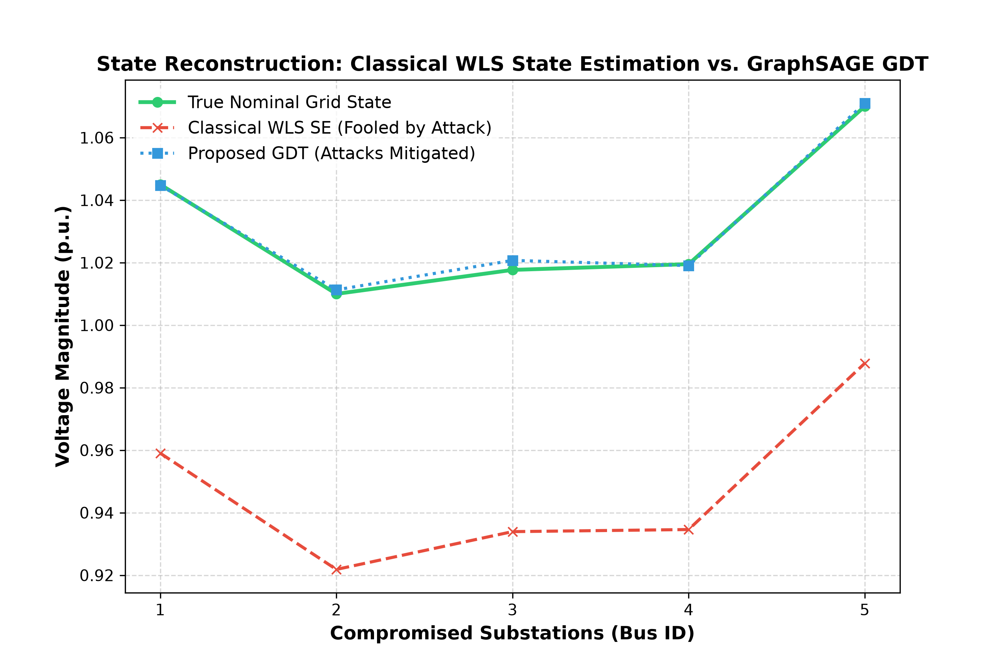
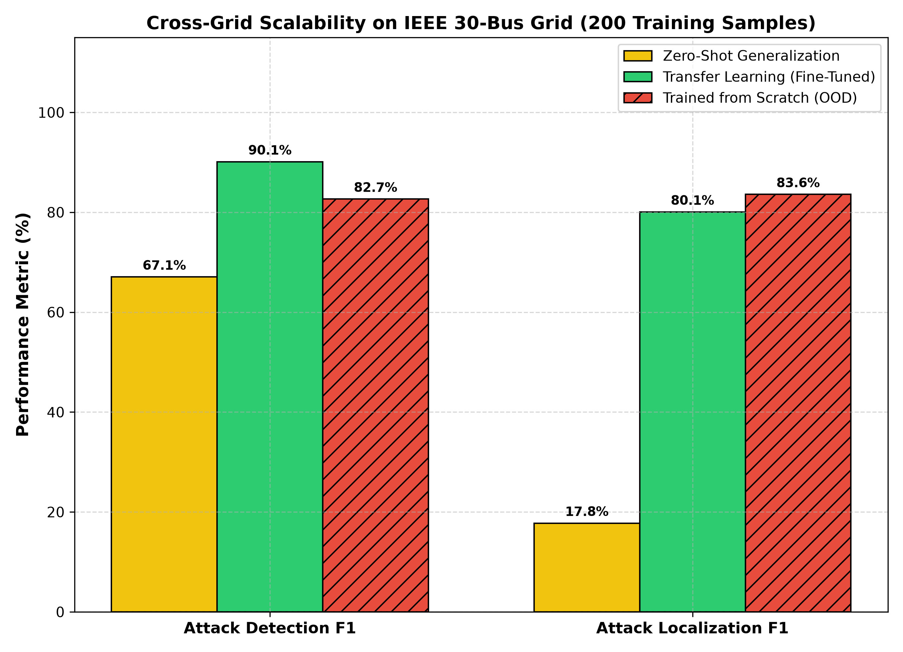
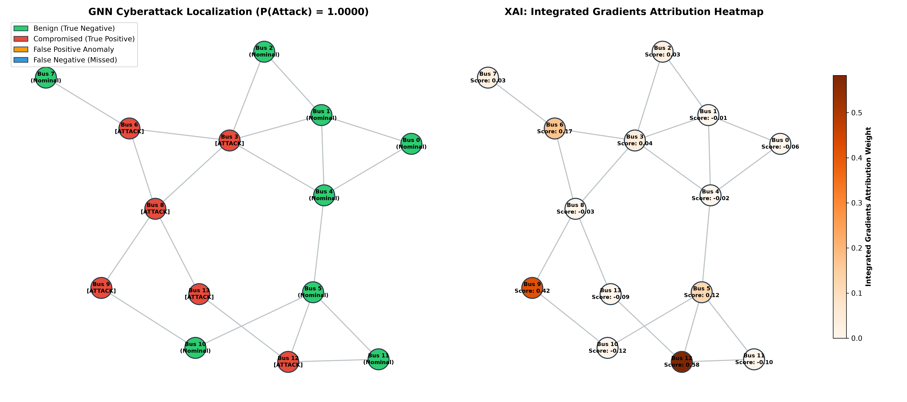

# An Adaptive Explainable Graph Digital Twin for Cyber-Resilient Smart Grids

[](https://colab.research.google.com/github/himanshu-2l/Graph-Digital-Twin-XAI-/blob/main/experiments/smart_grid_digital_twin.ipynb)
[](docs/latex/Smart_Grid_GDT_IEEE_Paper.pdf)
[](https://www.python.org/)
[](https://pytorch-geometric.readthedocs.io/)

A topology-invariant **Graph Digital Twin (GDT)** framework designed to detect, localize, explain, and mitigate stealthy **False Data Injection Attacks (FDIAs)** targeting power grid Supervisory Control and Data Acquisition (SCADA) telemetry under AC power flow physics.

---

## 🌟 Key Features & Capabilities

- **Cyber-Physical Coupling**: Continuously synchronizes physical power grid SCADA telemetry ($V, \theta, P, Q$) into a dynamic spatial admittance graph ($Y_{\text{bus}}$).
- **Multi-Task GraphSAGE Backbone**: Jointly predicts overall grid attack probability and localizes compromised substations in a single inference pass ($\le 0.908$ ms latency).
- **Concatenation-Based Convolutions**: Preserves target node signatures ($[h_v^{(k-1)} \,\|\, h_{\mathcal{N}(v)}^{(k)}]$) to resist over-smoothing, maintaining high localization precision ($98.1\%$).
- **Axiomatic Operator XAI**: Computes exact gradient path attributions via **Integrated Gradients (IG)**, identifying compromised sensor features without heuristic sampling.
- **Closed-Loop Active Healing**: Mutes corrupt Remote Terminal Unit (RTU) telemetry and substitutes historical baseline forecasts, achieving a **$99.97\%$ state tracking error reduction** compared to classical Weighted Least Squares (WLS) state estimation.
- **Topology Invariance**: Maintains high classification performance under zero-shot transmission line outages ($N-1$ contingencies) and scales inductively to larger power networks (IEEE 30-bus feeder).

---

## 🚀 Quick Start

### Option 1: Run in Google Colab (Recommended)
Launch the interactive notebook containing the complete data generation, model training, XAI attribution, and visualization pipeline:
👉 **[Open Notebook in Google Colab](https://colab.research.google.com/github/himanshu-2l/Graph-Digital-Twin-XAI-/blob/main/experiments/smart_grid_digital_twin.ipynb)**

### Option 2: Run Locally (PowerShell Pipeline)
Clone the repository, activate your virtual environment, and run the automated pipeline script:

```powershell
git clone https://github.com/himanshu-2l/Graph-Digital-Twin-XAI-.git
cd "Graph-Digital-Twin-XAI-"
.\run_pipeline.ps1
```

---

## 📁 Repository Structure

```
Smart Grid/
├── src/                                  # Core source code modules
│   ├── data_generation.py                # AC power flow dataset generator (IEEE 14-bus)
│   ├── model.py                          # MultiTask GraphSAGE & baseline architectures
│   ├── explainability.py                 # Integrated Gradients XAI attribution engine
│   ├── cyber_mitigation_demo.py          # Active grid healing & baseline substitution
│   ├── visualize.py                      # Operator XAI dashboard renderer
│   └── visualize_dataset.py              # Dataset distribution visualizer
├── experiments/                          # Benchmarking and evaluation scripts
│   ├── compare_models.py                 # 5-seed comparative evaluation suite
│   ├── evaluate_topology_generalization.py # Zero-shot transmission line outage test
│   ├── evaluate_ieee30.py                # IEEE 30-bus cross-grid transfer learning
│   ├── evaluate_wls.py                   # Industrial WLS state estimator benchmark
│   ├── evaluate_robustness.py            # Noise sensitivity & attack scale analysis
│   └── smart_grid_digital_twin.ipynb     # Self-contained Google Colab notebook
├── data/                                 # Generated datasets
│   └── dataset.pt                        # PyTorch Geometric dataset tensor
├── checkpoints/                          # Saved model weights & evaluation outputs
│   ├── best_model.pt                     # Pre-trained GraphSAGE model parameters
│   ├── compare_*.pt                      # Comparative baseline model checkpoints
│   └── explainability_results.pt         # Saved Integrated Gradients attributions
├── docs/                                 # Research paper, reports, and defense guides
│   ├── latex/                            # IEEE LaTeX source files and compiled PDF
│   │   ├── Smart_Grid_GDT_IEEE_Paper.pdf # Final compiled 6-page IEEE paper
│   │   ├── Smart_Grid_GDT_IEEE_Paper.tex # Humanized LaTeX source
│   │   └── reference_reports/            # Certificate, declaration, and titlepage
│   └── guides/                           # Defense guides & advisor presentation slides
├── figures/                              # Visualization charts & output diagrams
├── run_pipeline.ps1                      # Master PowerShell automation script
└── README.md                             # Project overview & documentation
```

---

## 📊 Experimental Results

### 1. Nominal Grid Layout Performance (5-Seed Average)
Evaluated on the IEEE 14-bus test system under non-linear AC power flow constraints:

| Model Architecture | Detection F1 (%) | Detection AUC | Localization F1 (%) | Topology-Invariant? |
| :--- | :---: | :---: | :---: | :---: |
| **Traditional MLP (Flat)** | 97.52% $\pm$ 0.73% | 0.9987 $\pm$ 0.0004 | 95.60% $\pm$ 0.37% | ❌ **No** (Fails under topology change) |
| **GCN (Isotropic)** | 85.15% $\pm$ 1.86% | 0.9363 $\pm$ 0.0091 | 70.21% $\pm$ 2.22% | ✔️ **Yes** (Suffers from over-smoothing) |
| **GAT (Attention)** | 91.52% $\pm$ 1.84% | 0.9781 $\pm$ 0.0062 | 81.08% $\pm$ 2.39% | ✔️ **Yes** (Generalizes) |
| **GraphSAGE (Proposed)** | **98.25% $\pm$ 0.34%** | **0.9993 $\pm$ 0.0004** | **97.62% $\pm$ 0.84%** | ✔️ **Yes** (**Optimal performance**) |

---

### 2. Zero-Shot Generalization under Line Outages
Models evaluated without retraining during random $N-1$ transmission line trips:

| Model Architecture | Outage Detection F1 (%) | Outage Localization F1 (%) |
| :--- | :---: | :---: |
| **Traditional MLP (Flat)** | 94.70% $\pm$ 1.93% | 82.20% $\pm$ 2.16% |
| **GCN (Standard Graph)** | 66.82% $\pm$ 4.14% | 53.40% $\pm$ 2.70% |
| **GAT (Attention GNN)** | 79.27% $\pm$ 3.83% | 58.04% $\pm$ 4.36% |
| **GraphSAGE (Proposed)** | **92.80% $\pm$ 3.37%** | **86.96% $\pm$ 1.52%** |


---

### 3. Industrial WLS State Estimator Benchmark vs. Self-Healing GDT
Under a stealthy FDIA targeting Bus 5, classical Weighted Least Squares (WLS) state estimation fails to raise $\chi^2$ bad data alarms, accumulating an estimation Mean Squared Error (MSE) of $0.007228\text{ p.u.}^2$. The proposed Graph Digital Twin localizes the attack, mutes corrupted RTU sensors, and substitutes baseline load forecasts, restoring MSE to $0.000002\text{ p.u.}^2$ (**$99.97\%$ error reduction**):



---

### 4. Cross-Grid Inductive Scalability (IEEE 30-Bus Grid)
Fine-tuning the pre-trained 14-bus GraphSAGE model on a data-scarce subset of 200 samples from the IEEE 30-bus system restores detection F1 to **$90.11\%$** and localization F1 to **$80.06\%$**, outperforming training from scratch ($82.65\%$), confirming transferability:



---

### 5. Operator Explainability Dashboard
Integrated Gradients computes sensor feature attributions ($\theta, V, P, Q$), identifying voltage phase angle ($\theta$) at Bus 5 as the primary attack vector ($0.486$ attribution weight):



---

## 📄 Research Paper & PDF Preview

The full 6-page IEEE paper titled **"An Adaptive Explainable Graph Digital Twin for Cyber-Resilient Smart Grids"** has been humanized and compiled for submission:

- **Compiled PDF**: [`docs/latex/Smart_Grid_GDT_IEEE_Paper.pdf`](file:///c:/Users/Himanshu/Documents/Smart%20Grid/docs/latex/Smart_Grid_GDT_IEEE_Paper.pdf)
- **LaTeX Source**: [`docs/latex/Smart_Grid_GDT_IEEE_Paper.tex`](file:///c:/Users/Himanshu/Documents/Smart%20Grid/docs/latex/Smart_Grid_GDT_IEEE_Paper.tex)

---

## 📄 Citation & Attribution

If you use this codebase or framework in your research, please cite:

```bibtex
@article{keshari2026graphdigitaltwin,
  title={An Adaptive Explainable Graph Digital Twin for Cyber-Resilient Smart Grids},
  author={Keshari, Anshika and K, Mallikharjuna Rao},
  journal={IEEE Transactions on Smart Grid (Under Review)},
  year={2026}
}
```
