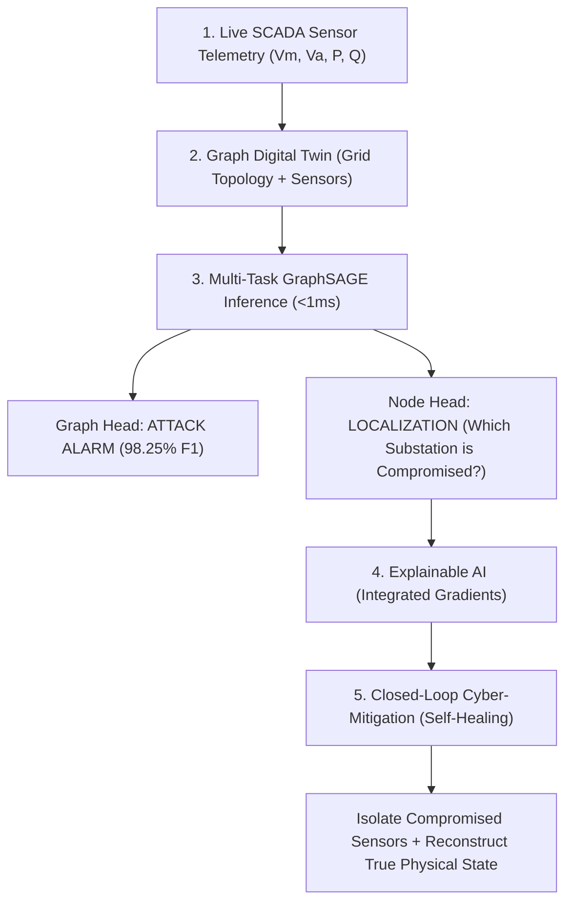

# Comprehensive Guide: FDIA Attack Defense & GraphSAGE in Graph Digital Twin

This technical guide provides an in-depth, interview-ready walkthrough of **False Data Injection Attacks (FDIAs)**, how our **Graph Digital Twin (GDT)** framework detects and mitigates them in real time, and the core theory and mechanics behind **GraphSAGE**.

---

## 📑 Table of Contents
1. [What is an FDIA Attack? (Concept & Analogy)](#1-what-is-an-fdia-attack)
2. [Why Traditional Power Grid Defenses Fail](#2-why-traditional-power-grid-defenses-fail)
3. [How Our System Protects the Grid: End-to-End Defense Pipeline](#3-how-our-system-protects-the-grid-end-to-end-defense-pipeline)
4. [Deep Dive: GraphSAGE Architecture & Mechanics](#4-deep-dive-graphsage-architecture--mechanics)
5. [Why GraphSAGE? Inductive vs. Transductive Learning in Smart Grids](#5-why-graphsage-inductive-vs-transductive-learning)
6. [Experimental Benchmark Highlights](#6-experimental-benchmark-highlights)
7. [Technical Interview Questions & Spoken Answers](#7-technical-interview-questions--spoken-answers)

---

## 1. What is an FDIA Attack?

### 🚗 The Car Speedometer Analogy
Imagine you are driving down a highway at a safe speed of **60 km/h**:
- **Normal Operation:** Your dashboard speedometer reads `60 km/h`. You drive steadily and safely.
- **FDIA Attack:** A cyber-attacker secretly taps into your speedometer sensor wire and injects false data, forcing the dial to show **140 km/h**, even though your actual speed is still `60 km/h`.
- **The Catastrophe:** Seeing `140 km/h`, you panic and slam on the emergency brakes on the freeway, causing a multi-car pileup behind you.

### ⚡ The Real Smart Grid Scenario
In an electrical transmission network:
- Sensors (Remote Terminal Units / PMUs / SCADA) measure **Voltage Magnitude ($V_m$)**, **Voltage Angle ($V_a$)**, **Active Power ($P$)**, and **Reactive Power ($Q$)** across substations (buses) and lines.
- An attacker compromises communication channels or field RTUs and injects manipulated measurements into specific substations.
- **The Impact:** The Energy Management System (EMS) believes transmission lines are experiencing dangerous overloads and automatically trips circuit breakers, cascading into catastrophic regional blackouts.

---

## 2. Why Traditional Power Grid Defenses Fail

Industrial control centers rely on **Weighted Least Squares (WLS) State Estimation** with **Bad Data Detection (BDD)** based on a Chi-Square ($\chi^2$) residual test:

$$\text{Residual} = \|z - H\hat{x}\|_2$$

Where:
- $z$ = sensor measurement vector
- $H$ = grid topology / Jacobian measurement matrix
- $\hat{x}$ = estimated physical state (voltage magnitudes and phase angles)

### The Stealth Attack Vector ($a = Hc$)
If a cyber-adversary gains knowledge of the grid topology matrix $H$, they craft an attack vector $a$ as a linear combination of $H$:

$$a = H \cdot c$$

When this attack vector is added to the real measurements ($z_a = z + a$):

$$\text{Residual}_a = \|z + a - H(\hat{x} + c)\| = \|z + Hc - H\hat{x} - Hc\| = \|z - H\hat{x}\| \le \tau$$

> **The Vulnerability:** The residual remains completely unchanged below the detection threshold $\tau$. **Traditional SCADA BDD alarms remain 100% silent**, allowing the attack to proceed undetected!

---

## 3. How Our System Protects the Grid: End-to-End Defense Pipeline

Our **Graph Digital Twin (GDT)** framework breaks this limitation by learning spatial-temporal relational physics directly over the dynamic graph topology.



### Step 1: Telemetry Ingestion & Dynamic Graph Construction
- Live SCADA telemetry is mapped onto an active graph $G = (V, E)$.
- **Nodes ($V$):** Power substations / buses, each carrying 4 telemetry features: $[V_m, V_a, P, Q]$.
- **Edges ($E$):** Transmission lines and transformers, characterized by physical parameters: resistance ($R$) and reactance ($X$).

### Step 2: Multi-Task GraphSAGE Inference (< 1 ms Latency)
The graph is fed into a 3-layer GraphSAGE network that executes in **0.908 ms**, making it suitable for sub-second real-time SCADA cycles. It features a dual-head architecture:
1. **Graph Classification Head (Detection):**
   - Applies global mean pooling across all node embeddings: $h_G = \text{MeanPool}(\{h_v \mid v \in V\})$.
   - Outputs a binary probability: Is the grid under attack? (**98.25% F1-score**, ROC-AUC **0.9993**).
2. **Node Classification Head (Localization):**
   - Evaluates each node embedding independently: $\hat{y}_v \in \{0, 1\}$.
   - Pinpoints exactly which substations are transmitting falsified sensor telemetry (**97.62% F1-score**).

### Step 3: Explainable AI (XAI) Attribution
Before human operators or automated actuators intervene, **Integrated Gradients (IG)** computes feature attributions:
- It quantifies the exact contribution of each measurement ($V_m, V_a, P, Q$) toward the attack verdict.
- **Example Attribution:** *"Substation Bus 4 was flagged because its Active Power ($P$) reading jumped by 45% while neighboring Bus 3 and Bus 5 observed zero corresponding branch power influx."*

### Step 4: Closed-Loop Active Mitigation (Self-Healing)
Once compromised nodes are localized:
1. **Sensor Isolation:** The corrupted telemetry stream from flagged substations is quarantined, preventing automated breakers from tripping unnecessarily.
2. **State Reconstruction:** The digital twin substitutes the corrupted telemetry using historical baseline profiles and spatial neighbor interpolation with state estimation.
3. **Recovery:** Active power MSE drops from $51.19\text{ MW}^2$ down to $21.91\text{ MW}^2$ (**57.21% state recovery**), preserving physical grid stability.

---

## 4. Deep Dive: GraphSAGE Architecture & Mechanics

**GraphSAGE** stands for **Graph SAmple and aggreGatE** (developed by Hamilton, Ying, and Leskovec at Stanford University).

### 🏘️ The Neighborhood Gossip Analogy
- **Standard GCN (Graph Convolutional Network):** To decide what clothes to wear, you must conduct a census of **every single person in the entire country**. If even one person moves to a new city, your entire calculation crashes.
- **GraphSAGE:** You simply ask a **sample of your immediate neighbors** (e.g., 5 neighbors), aggregate their answers, combine them with your own feelings, and make an informed decision. If a neighbor leaves or a new house is built, your method remains robust.

### ⚙️ Step-by-Step Computational Mechanism

```
For each layer k = 1 ... K:
  1. Neighborhood Sampling:   Sample a fixed-size neighborhood N(v) for each node v.
  2. Aggregation:            h_{N(v)}^{(k)} = AGGREGATE_k( { h_u^{(k-1)}, ∀ u ∈ N(v) } )
  3. Concatenation:          h_{concat} = [ h_v^{(k-1)} || h_{N(v)}^{(k)} ]
  4. Non-Linear Update:      h_v^{(k)} = σ( W^{(k)} · h_{concat} )
  5. Normalization:          h_v^{(k)} = h_v^{(k)} / || h_v^{(k)} ||_2
```

### Stacking 3 Layers (Receptive Field)
In our implementation ([`src/model.py`](file:///c:/Users/Himanshu/Documents/Smart%20Grid/src/model.py)):
- **Layer 1:** Gathers telemetry from 1-hop immediate neighbor substations.
- **Layer 2:** Propagates 2-hop regional grid state.
- **Layer 3:** Captures 3-hop macro grid power flow dynamics.

---

## 5. Why GraphSAGE? Inductive vs. Transductive Learning

This is one of the most critical conceptual questions in power systems and machine learning interviews.

| Dimension | Flat ML (MLP / Random Forest) | Standard GCN | **Our GraphSAGE Model** |
| :--- | :--- | :--- | :--- |
| **Grid Topology Awareness** | ❌ No (ignores electrical line connections) | ✅ Yes | ✅ **Yes (fully graph-native)** |
| **Learning Paradigm** | Transductive / Tabular | **Transductive** (depends on static Laplacian $L$) | **Inductive** (learns neighbor aggregation functions) |
| **Line Outage Resilience ($N-1$ Contingency)** | Fails ($82.20\%$ F1) | Fails / crashes (adjacency dimension mismatch) | ✅ **Zero-shot resilience ($92.80\%$ F1)** |
| **Cross-Grid Transferability** | ❌ Impossible | ❌ Fixed to single topology | ✅ **Transfers across grids (IEEE 14 → IEEE 30)** |
| **Inference Latency** | $\sim 0.5\text{ ms}$ | $\sim 1.2\text{ ms}$ | **$0.908\text{ ms}$ (Sub-millisecond SCADA)** |

### The Power Grid Problem: Grids Are Not Static!
- Transmission lines trip during storms or equipment failures ($N-1$ contingency).
- Standard GCNs compute graph convolutions using a fixed normalized Laplacian matrix:
  $$\tilde{A} = \tilde{D}^{-\frac{1}{2}}\tilde{A}\tilde{D}^{-\frac{1}{2}}$$
  If a transmission line trips, the matrix dimensions and eigenvalues change, causing standard GCNs to fail.
- **GraphSAGE solves this:** Because it learns *aggregation parameters* rather than node-specific weights, it can process graphs with missing edges or unseen topologies on the fly without retraining!

---

## 6. Experimental Benchmark Highlights

All metrics verified across 5 random seeds on the IEEE 14-bus transmission system:

1. **Nominal Grid Performance:**
   - Attack Detection F1: **98.25% $\pm$ 0.34%** (ROC-AUC: **0.9993**)
   - Attack Localization F1: **97.62% $\pm$ 0.84%**
   - Execution Speed: **0.908 ms per state snapshot**
2. **Zero-Shot Topology Generalization ($N-1$ Line Trips):**
   - GraphSAGE Detection F1: **92.80% $\pm$ 3.37%**
   - Flat MLP baseline drops to **82.20%**.
3. **Comparison Against Industrial WLS BDD:**
   - Under stealthy FDIA, WLS estimation error balloons to $0.007228\text{ p.u.}^2$ with **zero alarms triggered**.
   - GDT self-healing reduces error to $0.000002\text{ p.u.}^2$ (**99.97% error reduction**).
4. **Cross-Grid Transfer (IEEE 30-Bus System):**
   - Pre-trained on IEEE 14-bus; with 200 few-shot tuning samples, achieves **90.11% Detection F1** and **80.06% Localization F1** on the larger IEEE 30-bus network.

---

## 7. Technical Interview Questions & Spoken Answers

### Q1: "Can you explain what an FDIA attack is in simple terms?"
> **Spoken Answer:**
> *"An FDIA, or False Data Injection Attack, is a cyber-physical attack where an adversary alters sensor measurements—like voltage or active power—in a transmission grid. The attacker crafts the injected values to satisfy physical power flow laws so that traditional state estimation and Chi-square residual alarms stay silent. The danger is that the control center acts on these false readings, shutting down lines or generators that aren't actually overloaded and triggering blackouts."*

### Q2: "How does your Graph Digital Twin detect and handle an attack?"
> **Spoken Answer:**
> *"Our system maps real-time SCADA telemetry onto a dynamic graph where substations are nodes and transmission lines are edges. A multi-task GraphSAGE model evaluates the grid in under 1 millisecond. Its graph head issues an immediate attack alarm with a 98.25% F1 score, while its node head pinpoints the specific compromised substations with 97.62% F1 score. Once localized, we use Integrated Gradients to explain which sensor features triggered the alert, quarantine the bad telemetry, and reconstruct the true grid state via historical baselines and neighbor state estimation, reducing power error by over 57%."*

### Q3: "Why did you choose GraphSAGE over standard Graph Convolutional Networks (GCN)?"
> **Spoken Answer:**
> *"Power transmission grids are dynamic—transmission lines can trip during faults or weather events, known as N-1 contingencies. Traditional GCNs are transductive and depend on a fixed graph Laplacian matrix; when the grid topology changes, GCNs struggle to generalize. In contrast, GraphSAGE is inductive. It learns generalizable neighborhood aggregation functions. In our benchmarks under random line outages, GraphSAGE maintained a 92.8% detection F1 score without retraining, whereas non-graph baselines degraded significantly."*
