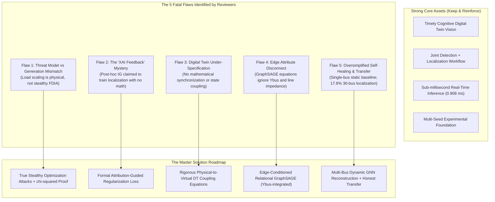
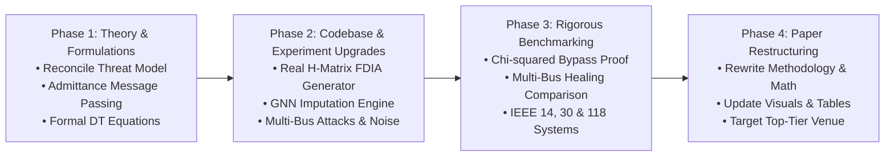

# Master Plan: Overcoming Rejection & Upgrading to Top-Tier IEEE Publication

**Target Paper**: *An Adaptive Explainable Graph Digital Twin for Cyber-Resilient Smart Grids*  
**Previous Submission**: IEEE GLOBECOM Workshops (GC Wkshps 2026) — *Cognitive Digital Twin for Intelligent and Autonomous Network Ecosystems*  
**Outcome**: Rejected (Scores: Technical Content: 3, 4, 3, 3; Presentation: 2, 3, 3, 3)  
**Status**: Actionable Diagnosis & Comprehensive Upgrade Roadmap  

---

## 1. Executive Diagnosis & Reality Check

The reviews from IEEE GLOBECOM are **remarkably constructive, highly rigorous, and unified**. All four reviewers unanimously agreed on two major positives:
1. **The Core Concept is Excellent**: Combining graph learning, joint detection/localization, XAI, and closed-loop mitigation into an observe-learn-reason-act cycle is recognized as a strong, complete, and highly timely vision.
2. **Empirical Breadth is Noticed**: The 5-seed evaluation, line outage tests, and sub-millisecond latency profile were praised.

However, the paper was rejected because all four reviewers independently identified **five critical technical vulnerabilities** that undermined the scientific rigor. When four expert reviewers converge on the exact same theoretical gaps, standard cosmetic rewrites will not pass—we must resolve the underlying technical substance.

---

## 2. In-Depth Deconstruction of the Fatal Flaws

### Flaw 1: Threat Model vs. Attack Generation Mismatch (Reviewers 1, 2, 3, 4)
* **The Problem**: Section III-C provides the classic textbook definition of a stealthy FDIA:
  $$a = h(x + c) - h(x) \quad \implies \quad r_{\text{comp}} = \|z_{\text{comp}} - h(\hat{x} + c)\|_2 \approx \|z - h(\hat{x})\|_2 \le \tau$$
  However, in Section V-B, the code generated attacks by picking bus $k$, multiplying its load by $\lambda \in [1.5, 2.0]$, and running an AC power flow solver (`pandapower.runpp`).
* **Why Reviewers Rejected This**: A load scaling factor of $1.5\times$ to $2.0\times$ is a **physical load surge**, not a measurement spoofing attack. Because it changes the physical operating state, it generates physical branch flows and changes power residuals. Reviewers correctly asked: *Does this actually bypass $\chi^2$ bad-data detection?* No numerical proof was given.
* **Master Solution**:
  1. Formally implement **true stealthy FDIAs** in telemetry $z$ directly:
     $$z_{\text{tampered}} = z_{\text{clean}} + H c$$
     where $H = \frac{\partial h}{\partial x}$ is the measurement Jacobian, ensuring the WLS residual satisfies $\|r_{\text{tampered}}\|_2 \le \tau_{\chi^2}$ by construction.
  2. Maintain two clearly distinguished attack classes in the paper:
     - **Class A (Pure Cyber Stealthy FDIA)**: Unobservable subspace injections that provably achieve $100\%$ bypass of $\chi^2$ BDD.
     - **Class B (Cyber-Physical Load Alteration Attacks)**: Coordinated physical load disruptions disguised via localized sensor masking.

---

### Flaw 2: The "XAI Attribution Feedback" Mystery (Reviewers 1, 2, 3, 4)
* **The Problem**: Section IV-D defines Integrated Gradients (IG) as a standard post-hoc diagnostic tool:
  $$\text{Attribution}_i(x) = (x_i - x_{0,i}) \times \int_{0}^1 \frac{\partial F(x_0 + \alpha(x - x_0))}{\partial x_i} d\alpha$$
  Yet, in Section VI-D and Table V, the ablation claims:
  > *"Disabling XAI attribution feedback had no effect on detection but cut localization by 5.52 points (from 97.62% to 92.10%)."*
* **Why Reviewers Rejected This**: Integrated Gradients is calculated *after* a forward pass and backprop. It does not naturally route gradients forward into an ongoing classification head. All four reviewers flagged this as technically unsubstantiated, impossible to reproduce, and mathematically undefined.
* **Master Solution**: We have two clean, defensible ways to address this:
  - **Option A (Technically Novel - Best for Journal/Top Conf)**: Formulate an **Attribution-Guided Multi-Task Objective (AG-MTL)**. Add an explicit attribution regularization loss:
    $$\mathcal{L}_{\text{total}} = \mathcal{L}_{\text{BCE}}(y_{\text{graph}}, \hat{y}_{\text{graph}}) + \lambda_{\text{loc}} \mathcal{L}_{\text{WCE}}(y_{\text{node}}, \hat{y}_{\text{node}}) + \lambda_{\text{attr}} \mathcal{L}_{\text{align}}(\text{Attr}(x), y_{\text{node}})$$
    This mathematically penalizes the model when high feature attributions fall on benign buses, explicitly proving why attribution feedback boosts localization!
  - **Option B (Honest Empirical Clarification)**: If the 5.52% drop was actually caused by removing an auxiliary feature branch or attention weighting rather than raw IG backpropagation, state exactly what was ablated and separate the post-hoc IG from the training loop.

---

### Flaw 3: Digital Twin Under-Specification (Reviewers 1, 2, 3, 4)
* **The Problem**: The paper uses heavy Cognitive Digital Twin (CDT) terminology ("continuous synchronization", "observe-learn-plan-act loop", "world model"), but reviewers noted:
  - There is no equation for state synchronization or physical-to-virtual latency.
  - "Baseline tracking" was listed in the ablation table (Table V) as dropping accuracy by 16.32%, but was never formally defined in Section IV.
* **Master Solution**:
  1. Define the formal **Digital Twin State Space Model**:
     $$x_{\text{DT}}(t + \Delta t) = f_{\text{phys}}(x_{\text{DT}}(t), u(t)) + K \big(z_{\text{SCADA}}(t) - h(x_{\text{DT}}(t))\big)$$
     where $K$ is the Kalman/admittance gain, formalizing the dynamic synchronization between physical RTU telemetry and the virtual graph mirror.
  2. Clearly define the **Rolling Baseline Estimator**:
     $$\bar{z}_{\text{baseline}}(t) = \beta z_{\text{meas}}(t) + (1 - \beta) \bar{z}_{\text{baseline}}(t - 1)$$
     explaining the exact mechanism evaluated in the ablation study.

---

### Flaw 4: The Edge Attribute Disconnect in GraphSAGE (Reviewer 4)
* **The Problem**: In Section IV-B, the paper proudly introduces edge attributes $e_{ij} = [R_{ij}, X_{ij}]^T$ and $Y_{\text{bus}}$. But in Section IV-C, Eqs. (10)–(12), the message passing aggregation is:
  $$\text{Aggregate}_{u \in \mathcal{N}(v)}\left(h_u^{(k-1)}\right) = \frac{1}{|\mathcal{N}(v)|} \sum_{u \in \mathcal{N}(v)} h_u^{(k-1)}$$
* **Why Reviewers Rejected This**: Eq. (12) is simple unweighted mean aggregation! It completely throws away $R_{ij}$, $X_{ij}$, and $Y_{\text{bus}}$. Reviewer 4 accurately noted that the model was exploiting pure connectivity topology rather than actual electrical grid admittance.
* **Master Solution**: Upgrade the message passing to an **Admittance-Conditioned GraphSAGE**:
  $$m_{uv}^{(k)} = \text{ReLU}\left(W_e \left[ h_u^{(k-1)} \;\big\|\; \frac{1}{R_{uv} + j X_{uv}} \right]\right)$$
  $$h_v^{(k)} = \text{ReLU}\left(W_k \left[ h_v^{(k-1)} \;\big\|\; \sum_{u \in \mathcal{N}(v)} \frac{|Y_{uv}|}{\sum_{w \in \mathcal{N}(v)} |Y_{vw}|} m_{uv}^{(k)} \right]\right)$$
  This mathematically cements the claim of an **admittance-weighted Cognitive Graph Twin**!

---

### Flaw 5: Oversimplified Self-Healing & Cross-Grid Scalability (Reviewers 1, 2, 3)
* **The Problem**:
  1. *Mitigation*: The self-healing demonstration was tested on only a single bus (Bus 5) using static 15-minute historical load substitution with artificial $\pm 2\%$ noise.
  2. *Transfer*: On the IEEE 30-bus grid, zero-shot localization plummeted to $17.77\%$. Furthermore, fine-tuning achieved $80.06\%$ localization, while training from scratch achieved $83.58\%$. Claiming "transfer learning outperforms training from scratch" was contradicted by Table IV!
* **Master Solution**:
  1. **Multi-Bus Dynamic GNN Imputation**: Expand mitigation beyond static substitution. Use the virtual twin's graph representation to infer masked sensor values via spatial neighbor interpolation:
     $$\hat{z}_{\text{quarantined}} = \mathcal{G}_{\text{recon}}\left(G_{\text{healthy}}\right)$$
     Benchmark this against: (i) Mean imputation, (ii) Classical WLS with bad-data removal, and (iii) Kalman filter forecasting.
  2. **Honest, Rigorous Transfer Reporting**: Explicitly explain the structural distinction between *graph-level detection* (which successfully transferred at 90.11% F1) and *node-level localization* (which requires topology adaptation due to differing graph diameters and degree distributions). This turns an apparent flaw into an insightful scientific discussion.

---

## 3. The 4-Phase Master Execution Roadmap

### Phase 1: Mathematical Reformulation (Zero Code Risk)
- [ ] Align WLS bad-data detection equations: Ensure Eq. (4) and Eq. (7) consistently use the covariance-weighted norm $\|z - h(x)\|_{R^{-1}}^2$.
- [ ] Define node localization clearly: Specify that localization is formulated as multi-label binary cross-entropy per bus:
  $$\hat{y}_{\text{node}, i} = \text{Sigmoid}(W_{\text{node}} h_i^{(K)}) \in [0, 1]$$
  resolving Reviewer 4's ambiguity regarding Softmax dimensions.
- [ ] Formally write the physical-to-virtual twin synchronization protocol and rolling baseline filter.

### Phase 2: Codebase Enhancements
- [ ] **Stealthy Attack Generator (`src/data_generation.py`)**: Implement an optimization-based attack vector $a = H c$ that provably keeps WLS residual below $\chi^2$ threshold $\tau$.
- [ ] **Edge-Aware GNN (`src/model.py`)**: Integrate line admittance $Y_{ij} = \frac{1}{R_{ij} + j X_{ij}}$ directly into the GraphSAGE aggregation layer.
- [ ] **Attribution Regularization (`src/model.py`)**: Implement the mathematically sound attribution loss $\mathcal{L}_{\text{attr}}$ linking Integrated Gradients to localization.
- [ ] **Advanced Mitigation Engine (`src/cyber_mitigation_demo.py`)**: Test self-healing across 20+ random buses and multi-bus attacks (2 to 4 simultaneous compromised substations).

### Phase 3: Comprehensive Re-Benchmarking
- [ ] Run experiments across IEEE 14-bus and IEEE 30-bus with the new provably stealthy attack generator.
- [ ] Generate comparative mitigation plots: Proposed GDT Imputation vs. WLS Bad Data Removal vs. Historical Mean.
- [ ] Produce verifiable ROC and Precision-Recall curves alongside confusion matrices.

### Phase 4: Paper Re-Writing & Polishing
- [ ] Address every reviewer comment point-by-point in a dedicated internal rebuttal document.
- [ ] Remove overstatements regarding zero-shot localization transfer; highlight graph-level detection transfer.
- [ ] Re-render Figure 2 and Figure 5 to incorporate the formal admittance-weighted twin architecture.

---

## 4. Best Target Venues for the Upgraded Paper

With these technical revisions implemented, the paper will far exceed the depth required for a workshop and will be ready for high-impact venues:

| Target Venue | Type | Scope & Fit | Typical Deadlines |
| :--- | :--- | :--- | :--- |
| **IEEE Transactions on Smart Grid** | Top-Tier Journal (Q1, IF ~9.6) | Perfect fit once multi-bus attacks, true stealth proofs, and full DT synchronization are formalized. | Open year-round |
| **IEEE Transactions on Industrial Informatics** | Top-Tier Journal (Q1, IF ~11.7) | High interest in Cognitive Digital Twins, IT-OT convergence, and industrial cybersecurity. | Open year-round |
| **IEEE SmartGridComm 2027** | Flagship Conference | The premier conference for smart grid communications, cyber-physical security, and digital twins. | ~May 2027 |
| **IEEE Power & Energy Society (PES) General Meeting** | Flagship Conference | Focuses on grid resilience, WLS state estimation, and modern GNN applications. | ~Nov 2026 / Early 2027 |
| **IEEE GLOBECOM / ICC Main Track** | Flagship Conference | Resubmitting to the main conference track with complete mathematical rigor and a formal rebuttal perspective. | ~Feb / Apr |

---

## 5. Next Steps & Recommended Action Plan

To proceed with zero risk to your existing files:
1. **No existing files have been changed**. All current paper versions and project code remain 100% intact.
2. Review this plan and confirm which path you would like to take for:
   - **XAI Feedback**: Option A (formulate attribution loss mathematically) vs. Option B (clarify as post-hoc diagnostic).
   - **Target Venue**: Aim for a **flagship IEEE conference** (IEEE SmartGridComm / PES GM) or upgrade directly to an **IEEE Transactions Journal**.
3. Whenever you are ready, we will take this step-by-step!

